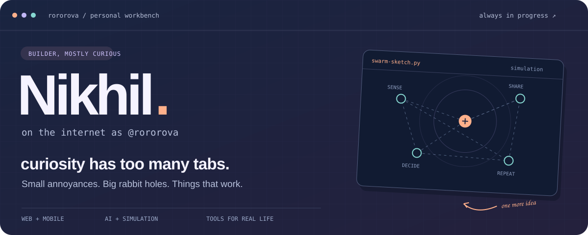
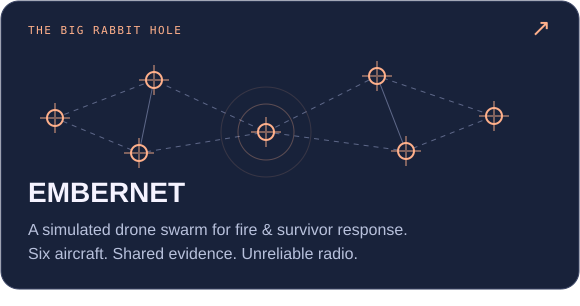
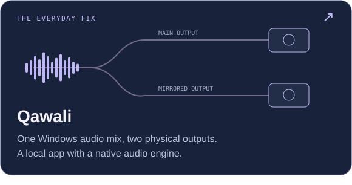
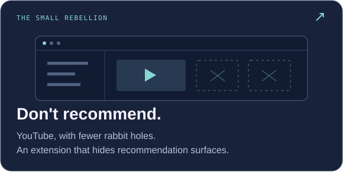
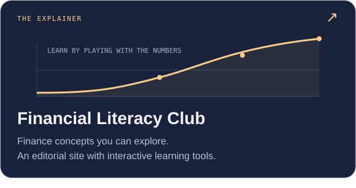

  <picture>
  <source media="(max-width: 600px)" srcset="./assets/workbench-mobile.svg" />
  
  </picture>

  <a href="https://nikhilthakuraan.in/"><strong>my corner of the internet ↗</strong></a>
  &nbsp;&nbsp;·&nbsp;&nbsp;
  <a href="#a-few-tabs-i-left-open">the projects</a>
  &nbsp;&nbsp;·&nbsp;&nbsp;
  <a href="#the-stuff-i-reach-for">the toolbox</a>

 

### Hey, I'm Nikhil.

I make things because an idea gets stuck in my head, or because something small is annoying enough to fix. That can mean hiding YouTube recommendations. It can also mean seeing how six simulated drones coordinate when their radios stop cooperating. Apparently, both belong in the same GitHub account.

I like the whole process: figuring out what something should do, making the interface feel right, and getting the less glamorous bits underneath to behave. Web apps, mobile apps, little utilities, AI experiments—I'll follow the problem wherever it goes.

AI is part of how I build. I'm also still learning the systems underneath, breaking things, and finding out which of my “quick ideas” are absolutely not quick.

 

## A few tabs I left open

  
  
  
  

Different sizes of problem. Same urge to make something work. Click a card to look around.

<strong>A little more about what's under the hood</strong>

- **[EMBERNET](https://github.com/Rororova/embernet):** six PX4-controlled aircraft in NVIDIA Isaac Sim, each with its own incident memory. They share evidence over a lossy mesh and keep making decisions when a radio link breaks. It's simulation work; real flight is still ahead.
- **[Qawali](https://github.com/Rororova/Qawali):** a React interface, a companion widget, and a native WASAPI engine for mirroring the Windows audio mix to one other output.
- **[Don't recommend](https://github.com/Rororova/Don-t-recommend-):** a Manifest V3 extension for Chrome and Edge that hides feeds, Up next, Shorts, and other recommendation surfaces while keeping search and subscriptions usable.
- **[Financial Literacy Club](https://github.com/Rororova/financial-literacy-club):** Next.js, interactive compounding and inflation explainers, custom SVG charts, and a React Three Fiber scene.
- **[Geotagger](https://github.com/Rororova/Geotagger):** a smaller Python utility that turns a photo's embedded GPS data into a readable location overlay.

 

## The stuff I reach for

| For the thing on screen | For the thing underneath |
| :--- | :--- |
| React · Next.js · TypeScript | Python · Node.js · PostgreSQL |
| React Native · Expo | Supabase · Firebase |
| CSS · Figma · a lot of tweaking | Git · automation · whatever the problem needs |

Lately, the rabbit holes have included simulation, native Windows audio, and making complicated ideas easier to explore on screen.

 

> I want to build something insanely useful. Until then, there's always another idea worth trying.

   
  <a href="https://nikhilthakuraan.in/">Come see what I'm making ↗</a>
    
  NIKHIL / ROROROVA &nbsp; · &nbsp; still figuring things out, still building.

